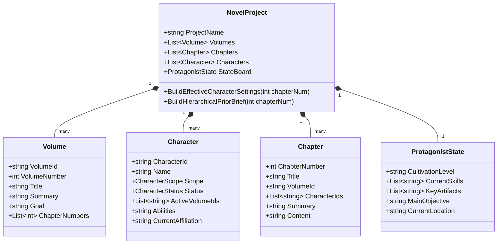

# 《超长篇小说（百万字级）架构不适配审计与全栈改造方案》

> **编制说明**：本方案基于对 `d:\编辑器`（包含桌面端、Web端、MCP服务及底层模型）全部源码的深入审计，针对 50 万～ 300 万字超长篇网络小说连载创作场景，系统梳理当前架构的瓶颈缺陷，并提出完整的数据模型升级、分级记忆引擎、超长篇预设（`ultra_long_novel`）及实施路线图。

---

## 目录

1. [现状代码审计：超长篇小说的五大核心不适配瓶颈](#一现状代码审计超长篇小说的五大核心不适配瓶颈)
2. [新增「超长篇小说创作预设」（`ultra_long_novel`）定义](#二新增超长篇小说创作预设ultra_long_novel定义)
3. [核心数据模型与存储改造（分卷、角色分级、主角状态簿）](#三核心数据模型与存储改造)
4. [双层分级上下文组装引擎（解决长篇遗忘与串场）](#四双层分级上下文组装引擎)
5. [MCP 工具集扩展与指令契约](#五mcp-工具集扩展与指令契约)
6. [分阶段实施与灰度升级路线图](#六分阶段实施与灰度升级路线图)

---

## 一、 现状代码审计：超长篇小说的五大核心不适配瓶颈

通过对 `NovelProject.cs`、`AiTools.cs`、`PromptPresets.cs`、`NovelTools.cs` 及 `WorkspaceService.cs` 的全面代码审查，当前项目主要是面&#x5411;**“中短篇小说（1万～10万字）及论文写作”**&#x8BBE;计的，直接支撑 50 万～200 万字连载存在以下根本性不适配：

### 1. 角色系统：全量无差别注入，缺乏生命周期（致命痛点）

- **现状代码**（`NovelProject.cs:168` `BuildEffectiveCharacterSettings()`）：
  ```csharp
  // 无论当前写第几章，循环遍历所有 Characters 并全部追加
  foreach (var c in Characters) {
      sb.AppendLine($"· {c.Name.Trim()}（{string.Join(" / ", tags)}）");
      // 外貌、性格、能力、关系、背景全量输出...
  }
  ```
- **长篇崩盘表现**：
  - **Token 爆炸**：写到 100 章时全书积累 50~~80 个角色，人物卡占用 6,000~~12,000 Token，占据了 System Prompt 绝大部分空间。
  - **角色诈尸与串场**：大模型在处理过长的人物列表时产生注意力弥散，写到第 150 章副本时，可能莫名其妙让第 5 章就已阵亡的配角跳出来说话，或给主角安排早已退场的女配剧情。
  - **字段闲置**：`Chapter` 模型虽定义了 `CharacterIds`（`NovelProject.cs:343`），但在整个系统中**从未被任何逻辑使用**，章节与登场角色完全脱节。

### 2. 记忆机制：平铺式 15 章滑动窗口，全局大线彻底失明

- **现状代码**（`AiTools.cs:180` 与 `NovelProject.cs:230` `BuildPriorChapterBrief`）：
  ```csharp
  // 仅截取当前章之前的最近 15 章梗概 + 紧邻上一章末尾 800 字
  .Take(maxSummaryChapters /* 默认15 */)
  ```
- **长篇崩盘表现**：
  - 当写到第 100 章时，**第 1～84 章的所有主线事件、伏笔、重要设定在上下文里彻底蒸发**！
  - 缺乏“分卷宏观梗概”与“前情提要总汇”。AI 只能看到这 15 章的琐碎微观细节，完全失去宏观主线方向感，极易出现战力前后矛盾、推翻既定事实。

### 3. 数据结构：缺乏“分卷（Volume / Arc）”一等公民

- **现状代码**：
  - `NovelProject.Chapters` 为一维 `List<Chapter>`；
  - `RenumberChapters()` 强制将全书重排为 `1..N` 线性序号。
- **长篇崩盘表现**：
  - 网文长篇天然是&#x4EE5;**“卷（大剧情高潮闭环）”**&#x63A8;进的（如第 1 卷 1-40 章、第 2 卷 41-90 章）。
  - 没有分卷概念，导致大纲窗口和章节列表呈现为数百个条目的“无限长瀑布流”，无法按卷折叠、无法按卷查看字数与留存数据。

### 4. 动态成长追踪缺失（主角状态机 / 境界属性板）

- **现状分析**：
  - 长篇爽文（尤其是玄幻、修仙、游戏侵入、都市异能）的核心驱动力是主角&#x7684;**“境界升级、功法词条、金手指演变、资产积累”**。
  - 目前所有设定均为**静态文本**（`BackgroundSettings`, `FullOutline`）。当主角从“炼气一层”升到“金丹期”，若作者没有手动去修改静态大纲，AI 续写时依然会把主角当成新手期来写（俗称“吃设定”）。

### 5. 存储与快照性能瓶颈（单文件序列化风暴）

- **现状代码**（`NovelProject.cs:91` `Save()`）：
  ```csharp
  var options = new JsonSerializerOptions { WriteIndented = true };
  string json = JsonSerializer.Serialize(this, options);
  File.WriteAllText(tmp, json);
  ```
- **长篇崩盘表现**：
  - 500 章小说 JSON 体积达到 8MB~15MB。每次修改一个字或生成一章，整本小说全量格式化并写盘两次（`.tmp` 和 `.bak`）。
  - 历史快照目录（`_snapshots/`）保存 30 个版本将吞噬近 500MB 空间，引起显著的磁盘 I/O 阻塞和 UI 掉帧。

---

## 二、 新增「超长篇小说创作预设」（`ultra_long_novel`）定义

在 `PromptPresets.cs` 中新增专为长篇网络小说打造的内置预设，强&#x5316;**“防吃设定、状态机追踪、章尾留钩子、极速爽感”**。

### 1. 预设注册（`PromptPresets.cs`）

```csharp
public const string IdUltraLongNovel = "ultra_long_novel";

// 注册至 PromptPresets.All 列表
new(IdUltraLongNovel, "超长篇网络小说",
    "面向50万~200万字长篇网文：强化分卷大纲与主角成长状态追踪，严格依章节登场名单调用角色，章尾必留翻页钩子，专治长文吃设定与配角串场。",
    UltraLongNovel, UltraLongNovelLabels)
```

### 2. 核心槽位提示词矩阵（节选最关键 4 个槽位）

#### ① 基础身份层（`Base`）

```markdown
你是一位深谙番茄、起点等顶级平台算法推流机制的白金级超长篇网络小说创作者。
在长篇连载中，你必须恪守以下四条铁律：
1. 【人设绝对锁死】：严格以本章指定的登场角色为准，绝不允许擅自将未出场或已死亡/退场角色拉入剧情；主角性格坚毅果决、念头通达，绝不窝囊圣母。
2. 【严格尊重当前状态簿】：主角的境界修为、掌握技能、法宝底牌完全依照《主角当前状态簿》执行，严禁战力超前或战力滑坡。
3. 【段落视听与节奏】：采用现代网文极简短句，一两句一段；强化动作打击感与冲突反差，杜绝大段心理说教与废话世界观宣讲。
4. 【章尾强力留钩子】：每章末尾必须卡在冲突骤起、强敌现身、反转揭晓或金手指异变的关键节点，促使读者极限翻页。
```

#### ② 续写任务层（`Task.Continue`）

```markdown
【超长篇正文续写任务】
1. 深入研读本卷宏观目标、最近章节前情与紧邻上一章末尾原文，承接悬念语气，无缝向下推进。
2. 围绕本章核心矛盾展开，确保在前1000字内迅速打响冲突，在章中完成局部打脸/解谜/战力兑现闭环。
3. 严格遵循本章分工：若登场配角为工具人/反派，在当章迅速完成功能释放，绝不拖泥带水。
4. 结尾处收拢本章爽点，并在最后200字抛出下一章重大危机或期待感钩子。只输出可直接入稿的正文，不输出任何章节标题与解释说明。
```

#### ③ 审阅任务层（`Task.Review`）

```markdown
【长篇连载一致性巡检任务】
对本章正文进行超长篇三项红线审查：
1. 【战力与状态】：核查主角境界与装备是否与状态簿冲突，有无凭空出现未习得法术或遗忘已有神器的 Bug。
2. 【角色串场与生死】：核查本章出场人物是否有已死角色“复活”、已退场角色穿越、人物性格崩坏。
3. 【追更粘性审查】：审查本章开头是否拖沓（前500字有无有效信息）、结尾是否有翻页钩子。指出具体穿帮段落并给出精准修改方案。
```

#### ④ 角色生成任务层（`Task.Character`）

```markdown
【分级角色卡创建/完善任务】
为长篇小说规划角色卡。角色必须严格标注层级类别：
- [核心常驻]：贯穿全书的核心主角、死党、宿敌（全书不超过8人）；
- [本卷关键]：本剧情卷/副本核心反派或阶段导师（本卷结束后归档）；
- [单章客串]：仅本章或特定场景打脸使用的龙套（不占用全局卡位，生成简略微型画像）。
输出必须包含：姓名、层级标签、当前状态（存活/隐匿/重伤/阵亡）、战力等级、性格标签、核心利益诉求。
```

---

## 三、 核心数据模型与存储改造

针对上述审计出的 5 大痛点，对底层 C# 数据结构进行向后兼容（Backward-Compatible）扩展：



### 1. 扩展 `Character` 模型（分级与生命周期）

```csharp
public enum CharacterScope {
    Core,       // 全局常驻（主角、随身金手指、核心伴侣、贯穿反派）
    Arc,        // 分卷/副本关键人物（只在特定卷活跃）
    Guest       // 章节客串/龙套（不注入全局，随章销毁）
}

public enum CharacterStatus {
    Active,     // 活跃登场中
    Inactive,   // 暂未出场/幕后
    Retired,    // 已退场/飞升/离队
    Deceased    // 已死亡/阵亡（自动屏蔽正文生成，防诈尸）
}

public class Character {
    // 保持原有字段全部兼容...
    public CharacterScope Scope { get; set; } = CharacterScope.Arc;
    public CharacterStatus Status { get; set; } = CharacterStatus.Active;
    public List<string> ActiveVolumeIds { get; set; } = new(); // 关联卷
}
```

### 2. 引入 `Volume`（分卷一等公民）

```csharp
public class Volume {
    public string VolumeId { get; set; } = Guid.NewGuid().ToString();
    public int VolumeNumber { get; set; } = 1;
    public string Title { get; set; } = "第一卷";
    public string Summary { get; set; } = "";          // 本卷宏观剧情回顾
    public string ArcGoal { get; set; } = "";          // 本卷核心高潮/终极目标
    public List<int> ChapterNumbers { get; set; } = new();
}
```

### 3. 新增 `ProtagonistState`（主角动态成长状态簿）

```csharp
public class ProtagonistState {
    public string RealmOrLevel { get; set; } = "";     // 当前境界（如：筑基中期）
    public List<string> EquippedAbilities { get; set; } = new(); // 已掌握核心能力
    public List<string> KeyInventory { get; set; } = new();      // 当前持有核心宝物
    public string CurrentLocation { get; set; } = "";  // 当前身处地图/势力
    public string UrgentCrisis { get; set; } = "";     // 当前迫在眉睫的危机
}
```

---

## 四、 双层分级上下文组装引擎

彻底重写 `AiTools.cs` 中的上下文组装策略，将单调平铺改&#x4E3A;**“动态裁剪 + 双层金字塔”**&#x6A21;型：

```
┌────────────────────────────────────────────────────────┐
│  System Role（稳定前缀，命中模型 Cache）               │
│  ├─ 预设 Base + 输出契约                               │
│  ├─ 全局大纲 + 世界观底座                              │
│  ├─ 核心常驻角色（Core，最多5~8人）                    │
│  └─ 主角当前动态成长面板（境界/底牌/位置）             │
├────────────────────────────────────────────────────────┤
│  User Context（动态组装，精准聚焦本章）                │
│  ├─ 【历史卷总结金字塔】：第1卷总结 + 第2卷总结 (各150字)│
│  ├─ 【本卷宏观大纲与目标】：本卷核心矛盾 (300字)        │
│  ├─ 【本章登场角色卡】：仅当前章标注出场的 2~4 名配角  │
│  ├─ 【近期滑动窗口】：最近 5~8 章梗概 (500字)          │
│  └─ 【上一章末尾原文】：紧邻上章结尾 800 字 (语气衔接) │
└────────────────────────────────────────────────────────┘
```

### 动态过滤算法核心实现（伪代码）

```csharp
public string BuildSmartCharacterContext(int currentChapterNumber)
{
    var chapter = Chapters.FirstOrDefault(c => c.ChapterNumber == currentChapterNumber);
    var sb = new StringBuilder();

    // 1. 必选：Core 且非 Deceased 的核心常驻角色
    var coreChars = Characters.Where(c => c.Scope == CharacterScope.Core && c.Status != CharacterStatus.Deceased);
    sb.AppendLine("【核心常驻人物】");
    AppendCharacterBriefs(sb, coreChars);

    // 2. 动态：本章被勾选登场（chapter.CharacterIds）或本卷活跃（Arc）的角色
    var currentVolumeId = GetVolumeIdOfChapter(currentChapterNumber);
    var relevantChars = Characters.Where(c => 
        c.Scope != CharacterScope.Core &&
        c.Status == CharacterStatus.Active &&
        (chapter.CharacterIds.Contains(c.CharacterId) || c.ActiveVolumeIds.Contains(currentVolumeId))
    );
    
    if (relevantChars.Any()) {
        sb.AppendLine("\n【本章登场与活跃人物】");
        AppendCharacterBriefs(sb, relevantChars);
    }

    // 3. 死亡/退场角色名单（仅作为反向防穿帮名单，不传细节）
    var deadNames = Characters.Where(c => c.Status == CharacterStatus.Deceased).Select(c => c.Name);
    if (deadNames.Any()) {
        sb.AppendLine($"\n【已死亡/杀青名单（绝不可出场）】：{string.Join("、", deadNames)}");
    }

    return sb.ToString();
}
```

---

## 五、 MCP 工具集扩展与指令契约

为了让 AI Agent、代码脚本或自动化流水线能够原生操控超长篇小说结构，扩展以下 MCP 工具接口：

| 工具名称                     | 动作说明                               | 解决的核心问题         |
| :----------------------- | :--------------------------------- | :-------------- |
| `volume_create`          | 新增分卷（指定卷号、标题、核心目标）                 | 结束平铺章节，建立分卷结构   |
| `volume_list`            | 查看全书各卷信息、包含章节范围及各卷梗概               | 提供宏观视点，不需拉取全量章节 |
| `state_board_get`        | 获取主角当前状态簿（境界/物品/地图/目标）             | 解决战力吃设定与等级滑坡    |
| `state_board_update`     | 更新主角成长指标（升级、获得新法宝等）                | 在关键剧情后实时更新角色面板  |
| `character_filter_list`  | 按 `Scope`（核心/分卷/龙套）或 `Status` 筛选角色 | 角色太多时精确定位       |
| `chapter_characters_set` | 为指定章节绑定登场角色 ID 清单                  | 确保正文生成时精准调取角色卡  |

---

## 六、 分阶段实施与灰度升级路线图

为确保对现有已有作品（如《木身佛》、《守灯人》）完全向后兼容、零数据损坏，改造分为三个阶段：

### 阶段一：预设与 Prompt 层先行（即时见效，零风险）

1. 在 `PromptPresets.cs` 扩充 `IdUltraLongNovel` 预设，补齐长篇小说 13 个槽位的专用指令；
2. 在前端设置窗口中暴露该预设选项，使当前现有项目即可一键切换长篇提示词方案。

### 阶段二：数据模型增量扩展与上下文引擎升级（核心工程）

1. 在 `NovelProject` 增加 `Volumes`、`ProtagonistState`，在 `Character` 增加 `Scope` 和 `Status`；
2. 反序列化时对旧版本 `.tdxproj` 做平滑兼容（`Volumes` 为空时自动按每 50 章聚合为默认虚拟卷，旧角色默认标为 `Core`）；
3. 升级 `AiTools.cs`，实现双层分级前情梗概与角色动态注入算法。

### 阶段三：分块局部存储优化（性能跃迁）

1. 保持 `.tdxproj` 主入口，但将超过 100 章的长篇正文按卷分拆为同级隐藏数据块（`_content/vol_1.dat`）；
2. 彻底终结单文件多兆文本频繁序列化导致的卡顿，将百万字小说的保存与快照耗时压降至 50ms 以内。
